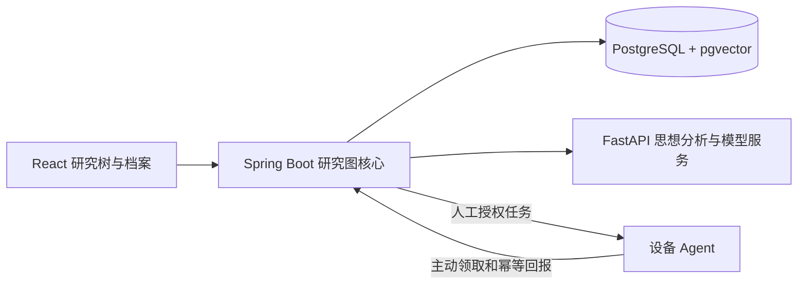

# 循序研究图核心

Java Research Graph Core 是结构和业务事实的唯一写入入口。Python 引擎无数据库连接，只接收 Java 准入的上下文并返回建议。React 使用服务端持久化的节点和关系，不从会话临时推算树。

## 实体与边界

| 实体 | 身份和规则 |
|---|---|
| Space / Node | 空间根固定；思想和行动节点；无研究生命周期状态 |
| Relation | 普通继承由 parent_id 保存；共同分支用来源列表、独立关系和审核来源快照保存 |
| Conversation / QA | 起始节点与上下文快照永久保留；原问答不可覆盖；标题和精确问答 ID 支持原文定位 |
| Thought / Cluster / Ref | 一主多辅；出生向量保留，工作向量独立；不同问答才累计簇有效数量 |
| Summary | 直接总结与祖先上下文分开；历史版本保留，子孙结果不向父节点回写 |
| Proposal / Audit | 预览后人工审批；结构指纹变化拒绝旧审核；严格最近版本撤销 |
| Transplant | 子树独立成空间；原会话来源不改；历史路径营养包不继承兄弟分支 |
| Run / Event / Job | 设计与执行分离；每次重试新 Run；事件 ID 去重，顺序和状态迁移校验 |
| Device | 持有独立令牌；主动领任务；工作目录限制；已领取任务不自动重复派发 |

## 证据生长事件

1. 接收问答并确定不可变会话锚点，构造祖先路径、节点直接总结、已审核来源和移植营养背景。
2. Python 返回思想坐标，Java 验证引用真实性、空间、数值向量及冻结条件。
3. 按明确研究意图累积不同问答；已有承载节点强化引用，有效新簇或人工标记独立思想才创建节点。
4. 同一事务保存原始问答、思想、引用、节点、审计及 outbox。失败不部分提交。
5. 移动、叶节点合并、共同分支、冻结和移植先保存可审阅预览；人工批准时重新验证结构。

## 当前实现的算法边界

默认思想及核心概念坐标采用本地 BGE 中文 512 维语义嵌入，研究意图由 DeepSeek 判定、Java 校验后形成语义簇。旧出生坐标保留，新编码追加不可变版本。候选阈值、意图判定质量、自动剪枝和布局评分仍需真实数据校准。具体规则见 SEMANTIC-SPACE.md。当前自然树使用稳定的分层向上布局、曲线枝干和独立关联展示。

PostgreSQL 持久化包括关系约束和永久证据触发器；版本对象使用 JSONB。当前写操作用全图修订锁串行提交，并在锁内调用有超时的 AI 服务，适合单用户初版，较大规模需要改为版本校验的两阶段分析与分空间锁。outbox 已事务保存，尚未部署消息消费者。Redis / MinIO 部署配置已经提供，当前业务尚未接入缓存及对象上传。当前仅本机开发访问，非完整多人权限产品。
